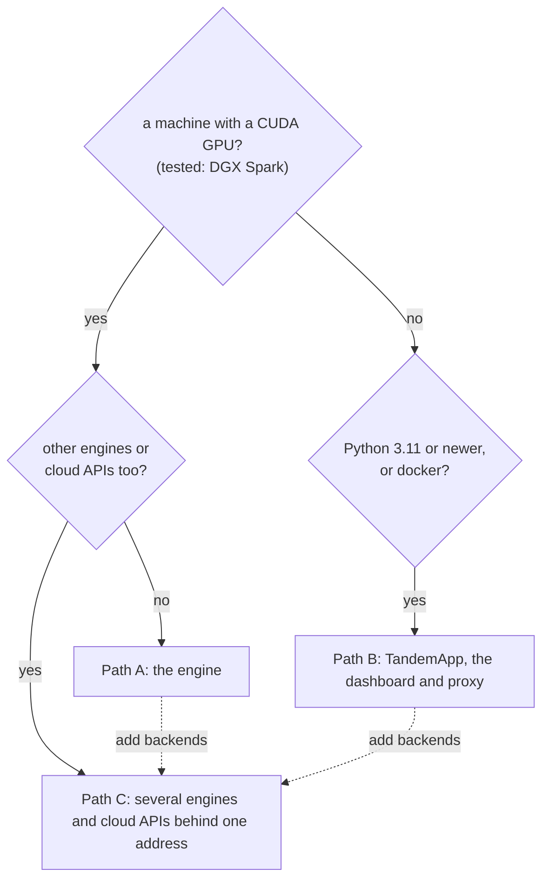

# Installing TandemEngine

This page installs the engine. It runs the models and needs a CUDA GPU; its test board is the DGX Spark ([The test environment](overview.md#the-test-environment)). The dashboard, the Chat tab and the proxy are TandemApp, a separate project with its own docs: it needs only Python, runs on any machine, and talks to the engine over HTTP. Find your setup in the table below, then follow the sections it names.

## Setups, and which ones work

The engine runs alone, or behind TandemApp together with other engines and cloud APIs. The table below says which combinations work today, and how far each one is tested.

| setup | how | state |
|-|-|-|
| the engine alone | `install.sh` on the board (this page) | live |
| the engine and cloud APIs, one address | `tandem-app` on the board or another machine, with the engine and the cloud API as backends ([TandemApp's docs](https://github.com/TandemLLM/TandemApp/blob/main/docs/README.md)) | live, with DeepSeek |
| the engine and other engines on other machines | `tandem-app` as above, the other engines as `vllm`, `sglang` or `generic` backends ([TandemApp's docs](https://github.com/TandemLLM/TandemApp/blob/main/docs/README.md)) | built; vLLM and SGLang live behind the proxy on their own |
| the engine and a second GPU engine on one larger machine | each engine on its own GPU, `tandem-app launch` for the second | built |
| the engine and a second GPU engine on one DGX Spark | the engine plans its memory as if it owns the board (up to 77 GiB during a prefill, plus its small models); a board out of memory stops answering until it is power cycled | not supported |

*Setups and their state in this release. *Live*: run on the test board in the 0.4.0 series. *Built*: the code supports it and its tests pass, but no live run is recorded.*



*Which install path. A machine with the GPU gets the engine (path A); any other machine gets TandemApp, the dashboard and proxy (path B, [TandemApp's docs](https://github.com/TandemLLM/TandemApp/blob/main/docs/README.md)); either grows into path C by adding backends behind TandemApp, which lists the engine as one backend among others ([Other engines and cloud APIs beside the engine](#other-engines-and-cloud-apis-beside-the-engine)).*

## What the engine needs

The engine is tested on one NVIDIA DGX Spark, a GB10 GPU (`sm_121`) with 128 GB of memory that the CPU and the GPU share, running Linux on aarch64. On another CUDA GPU the installer turns off the one kernel built for the GB10, and the engine runs best effort. The installer checks four things before it changes anything: an NVIDIA GPU and driver, the CUDA compiler (one kernel builds on its first use), about 70 GB of free disk, and 64 GiB of free memory at the start. With `--setup` it downloads only Wren's model, so it asks for about 5 GiB of disk beside the Python environment and 8 GiB of free memory; `use-profile.sh` checks the disk and the memory a profile needs before it downloads or starts it.

The software is pinned. The engine imports PyTorch 2.13 built for CUDA 13.0, torchvision 0.28 (the CUDA 13.0 build that matches that torch), Triton 3.7, transformers 5.12, Pillow 11.3, safetensors and numpy, and nothing else. Python 3.11 is the tested version; under 3.12 one grammar test fails. The installer's lock lists every package with its version, for aarch64 and x86_64.

Two of those packages are there for images. Pillow decodes a request's images, and torchvision is the backend of the image processor that the checkpoint ships. The engine pins that backend (`--image-backend torchvision`) and refuses to start without it, because transformers would otherwise fall back to its Pillow backend, whose patches differ by up to two 8-bit levels after a resize (measured, 0.4 % of the values of one resized image). Every cache keys on those patches, so the backend has to be fixed. `--image-backend pil` is the explicit choice without torchvision, and `--vision off` serves text only.

Run one engine per board. Two engines loading side by side run the board out of memory, and a DGX Spark in that state stops answering until it is power cycled. [One engine per board](operations.md#one-engine-per-board) explains how the scripts enforce it.

## A new box: setup mode, then the Setup Guide

Since 0.8.1 a new DGX Spark needs two commands and no Hugging Face token. Every file a profile reads is public on Hugging Face: our own packs, the vendors' releases, and turboderp's Flash-Next packs ([Qwen3.8-Flash-Next](flash-next.md)).

```sh
curl -fsSLO https://raw.githubusercontent.com/TandemLLM/TandemEngine/v0.16.0/install.sh
bash install.sh --setup --yes
```

The first line fetches the installer from the release tag. With `--setup` the installer puts the code and the Python environment in place and downloads only Wren's model (Qwen3.5-2B, 4.3 GB), the setup guide's assistant, and the two Wikipedia shards of the lookup corpus (1.2 GB). The corpus itself needs the model's tokenizer, so `ops/use-profile.sh` builds it once the model is on the disk. It writes the configuration with no weights and starts setup mode on `127.0.0.1:8000`: the Setup Guide's API (`/v1/setup/*`), Wren, and no model loaded. The engine serves no page.

Then pick a model with the Setup Guide. The guide shows each model with its weight packs, checks that the choice fits in memory, downloads it and starts the engine; a new browser opens its simple form, three pages: the model, its weights, and one page of folded settings. The switch at the top brings back all eight steps, through the model, the weights, the tools and the parallel slots. `docs/setup.md` describes the page.

- In a terminal on the box, run `~/TandemLLM/bin/tandem setup`: the same guide, step by step.
- In a browser, use TandemApp's Setup page and point it at the engine, `http://127.0.0.1:8000` on the box itself.
- From another computer, open an SSH tunnel to the box first, `ssh -L 8000:127.0.0.1:8000 <user>@<box>`, and use the same address on that computer.
- On your network, install with `--host 0.0.0.0` and use `http://<box>:8000` from any computer that reaches the box. Until an admin password is set, anyone who reaches the port can run the setup.

The installer prints the addresses when it finishes, and while the engine is in setup mode TandemApp's page opens on the Setup Guide by itself.

### Advanced: from the command line

The Setup Guide runs `ops/use-profile.sh` for you. To pick the weights from a shell instead, run the copy in `~/TandemLLM/run/ops/`, next to the `serve.env` the installer wrote:

```sh
bash ~/TandemLLM/run/ops/use-profile.sh --list
bash ~/TandemLLM/run/ops/use-profile.sh <profile> --dry-run
bash ~/TandemLLM/run/ops/use-profile.sh <profile>
```

`--list` prints every profile and marks the active one. With `--dry-run` the script prints every file's URL and size and changes nothing. Without it, the script downloads what the profile needs and checks every weight file against the sha256 the hub lists. It then leaves setup mode, starts the engine on port 8000 and sends one smoke request. Since 0.8.2, `community/<id>` runs a pack someone else published ([Community weights](community-weights.md)).

| profile | downloads | size | free disk |
|-|-|-|-|
| `flashnext-3.05` | the pack's branch of `turboderp/Qwen3.8-Flash-Next-exl3`; the drafts' corrector (`0xBakeer/TandemLLM-Qwen3.8-Flash-Next-EXL3-3.05-corrector`, into `~/TandemLLM/src/ops/correctors/qwen3.8-flash-next`) | 85.1 + 0.035 GB | 145 GB |
| `exl3-4.5` | `0xBakeer/TandemLLM-Qwen3.8-27B-EXL3-4.5`; the K3 drafters and the K4 head (`...-EXL3-drafters`); the BF16 drafters (`...-DFlash2-b8`, `-b16`, into `~/TandemLLM/src/train`); the base checkpoint `Qwen/Qwen3.8-27B-FP8`, without `mtp.safetensors` | 18.4 + 1.9 + 7.7 + 30.4 GB | 118 GB |

*What two of the profiles download on a new box. Free disk: the download plus the 60 GB the script keeps free after it.*

A folder appears only when all its files are there. If a download stops, run the same command again: it keeps the files that finished and continues. The corrector file of `flashnext-3.05` is checked against the sha256 the profile pins. If it does not download, the script prints a warning and goes on, and Flash-Next drafts without it: the same text, fewer drafts accepted. The engine then needs about 80 GiB of free memory for a 27B profile and 70 GiB for `flashnext-3.05`. If the profile does not come up, the script brings setup mode back.

The installer checks out the tag `v0.16.0` from the repository `--repo` names, the public one by default. Where the tag is missing, `curl` fails with a 404, and the installer stops at its clone step with “no tag, branch or commit 'v0.16.0'”. `--ref` picks another release, and `--repo` another repository.

## Updating a box in setup mode

A box with a running profile counts as configured, and `--setup` alone refuses to touch it. To update, add `--force-setup`: the installer stops the engine, checks out the new tag and comes back in setup mode. Then switch to the profile again; its files are on disk already, so nothing downloads twice.

```sh
bash ~/TandemLLM/src/install.sh --setup --force-setup --yes --ref <new tag>
bash ~/TandemLLM/run/ops/use-profile.sh flashnext-3.05
```

## The installer

Without `--setup`, one command sets up the NVFP4 profile, StairCut included:

```sh
curl -fsSL https://raw.githubusercontent.com/TandemLLM/TandemEngine/v0.16.0/install.sh | bash
```

The installer works in seven steps, and each step is skipped when it is already done, so running it again updates an install and resumes a download that stopped.

1. Checks. The GPU needs its driver and the CUDA compiler, the disk and the memory need room, and Hugging Face must answer.
2. The engine: a clone of the repository `--repo` names into `~/TandemLLM/src` at the pinned release, `v0.16.0`.
3. A Python venv in `~/TandemLLM/venv` with the pinned packages; torch and torchvision come from the CUDA 13.0 index. If neither `uv` nor Python 3.11 is on the machine, the installer fetches `uv` first.
4. The weights, into the normal Hugging Face cache: the vendor's FP8 checkpoint (it supplies the tensors the NVFP4 overlays do not replace, and the tokenizer), the four NVFP4 files and both fine-tuned drafters. With `--setup`, only Wren's model; `use-profile.sh` fetches the rest later.
5. A lookup corpus built from public text (one English and one German Wikipedia shard, plus Python sources from the venv's own packages, about 31 million tokens). `--no-corpus` skips it. With `--setup`, only the two shards: `use-profile.sh` builds the corpus for the model it installs, under `corpus/tokenizers/`, with no network.
6. The configuration: `~/TandemLLM/run/ops/serve.env`, the release's `ops/serve.env` with this machine's paths, and a control script, `~/TandemLLM/bin/tandem`.
7. The start: the engine starts, the script waits for `/health`, and a smoke test prints tokens a second. `--no-start` stops after step 6.

The weights are public. `--hf-token` (or `HF_TOKEN`) is needed only for a repository that is private or gated, and a stored `hf auth login` works too. The table in [commands](reference/commands.md) lists every option; the most used ones are `--setup` ([A new box: setup mode, then the Setup Guide](#a-new-box-setup-mode-then-the-setup-guide)), `--repo` (another repository, such as a fork), `--dir` (default `~/TandemLLM`), `--port` and `--host` (default `127.0.0.1:8000`), `--ref` (any git ref; `v0.2.0-staircut` is the paper's release), `--hf-token`, `--systemd` for a systemd user unit, `--dry-run` to print every step and change nothing, and `--uninstall`.

[reference/commands.md](reference/commands.md#installsh-options) lists every option.

The installer's corpus is not the corpus the paper's numbers come from; that one is not published. With the installer's corpus, or with `--no-corpus`, the lookup drafter proposes different continuations, so speeds can differ from the paper's. How much is not measured. On a CUDA GPU other than the GB10 the installer turns off the skinny NVFP4 kernel, which is built for `sm_121a` only, and StairCut's cost tables still come from the Spark, so such GPUs are best effort.

## After the install

The install directory holds everything the installer wrote:

| path | what |
|-|-|
| `~/TandemLLM/src` | the repository at the installed release |
| `~/TandemLLM/venv` | the Python environment, about 8 GiB with the CUDA wheels |
| `~/TandemLLM/corpus` | the lookup corpus |
| `~/TandemLLM/run/ops/serve.env` | the served profile with this machine's paths, rewritten on every run of the installer |
| `~/TandemLLM/run/local.env` | your own settings; `serve.env` reads it last and the installer never touches it |
| `~/TandemLLM/state` | the tokens file (the metrics token, and the admin password if you set one), once you create it |
| `~/TandemLLM/bin/tandem` | the control script |
| `~/.qwen38-spark-engine/` | the engine's state: the usage ledger, the conductor's documents and journal, memory notes, the disk tier, small models |

*The layout of an installed engine.*

The control script takes one command:

```sh
~/TandemLLM/bin/tandem start      # ops/start.sh with run/ops/serve.env; waits for /health
~/TandemLLM/bin/tandem stop 120   # SIGTERM, wait for the drain, kill only after it
~/TandemLLM/bin/tandem restart
~/TandemLLM/bin/tandem status
~/TandemLLM/bin/tandem smoke      # /v1/models and one short completion, with tok/s
~/TandemLLM/bin/tandem logs       # follow the engine's log
```

## Engine only, or the chat (beta)

A new install serves the engine alone: the OpenAI API under the served model's own name, the dashboard reads under `/v1/dashboard/*` and the caches. Nothing runs beside it: no extension (no `TandemLLM` model, router, user memory, packages, library or session monitor), no decision models, narrator, shadow reader or roles. One setting decides it, `QSE_MODE` in `serve.env`: `engine` or `chat`.

In chat mode (beta) the engine loads TandemApp's conductor as its extension (`QSE_EXT`), with the small models the weight profile names; TandemApp's TandemNode runs chatd, the Chat tab's service, and the engine runs none. Turn it on with `install.sh --with-chat --app-wheel FILE`, TandemApp's wheel (a re-run works too), with the Setup Guide's *Chat (beta)* switch, which writes `QSE_MODE=chat` to `run/setup.env` and turns on Laya's decision models with it, or with `QSE_MODE=chat` in `run/local.env` and `tandem restart`. `--engine-only` turns it off again, and TandemNode stops a running chatd once the engine comes up in engine mode. On a box set up in the Setup Guide its switch decides: `run/setup.env` is read after the installer's `QSE_MODE`, so the two flags there only warn. The last block of `ops/serve.env` applies the mode after the weight profile, `run/setup.env` and `run/local.env`; `ops/use-profile.sh` keeps it.

An upgrade keeps each box's mode. Left empty, `QSE_MODE` is `chat` on a box whose conductor directory (`QSE_CONDUCTOR_CONFIG`, by default `~/.qwen38-spark-engine/conductor`) exists, so a box that ran the conductor stays a chat box with its documents, memory and sessions; `QSE_CONDUCTOR_CONFIG=off` set by hand stays engine only. `/health` and `/v1/models` say `"mode": "engine"` or `"chat"` and what is `loaded`: the conductor and its monitor's mode, the decision models, the narrator, the loaded roles, and whether chatd answers; `extensions` names the extension that runs.

## The first request

The server speaks the OpenAI API on port 8000. In engine-only mode it serves the engine under its own model name (`/v1/models` lists it). With the chat on, it serves one model called `TandemLLM`, and any model name a client sends is served as `TandemLLM`:

```sh
curl -s localhost:8000/v1/chat/completions -H 'Content-Type: application/json' \
    -d '{"model": "TandemLLM", "messages": [{"role": "user", "content": "Say hello."}]}'
```

Point other clients at the same address:

| client | setting |
|-|-|
| an OpenAI SDK | `OPENAI_BASE_URL=http://<host>:8000/v1` and any key |
| opencode | an OpenAI-compatible provider with that base URL and the model `TandemLLM`; with the chat (beta) on it gets the `coding` profile by itself |
| Open WebUI | an OpenAI connection to that base URL, with the connection header `X-OpenWebUI-Chat-Id: {{CHAT_ID}}` so each chat is its own conductor session with the chat (beta) on ([TandemApp's docs on profiles and the router](https://github.com/TandemLLM/TandemApp/blob/main/docs/conductor.md)); it gets the `chat` profile |
| `curl`, a script | as above; with the chat (beta) on it gets the `general` profile |

*Pointing a client at the engine.*

An engine-only box ([Engine only, or the chat (beta)](#engine-only-or-the-chat-beta)) has no profiles: every client gets the raw path under the served model's own name, so opencode and Open WebUI name that model instead of `TandemLLM`. With the chat (beta) on, the header `X-Tandem: raw` gives the engine without the conductor for one request. That is the release's raw path, the one the benchmarks and the paper measure. [TandemApp's docs](https://github.com/TandemLLM/TandemApp/blob/main/docs/README.md) explains the profiles (“Profiles and the router”).


*Open WebUI with `TandemLLM` as its model: a demo request on the test board in October 2026, served under the `chat` profile, with the reasoning folded into “Thought for 1 seconds”. Only the message pane is shown.*


*opencode with `TandemLLM` as its provider: the end of a demo task on the test board in October 2026, under the `coding` profile. The model added a function, tested it, asked Laya for a verdict on the test log, removed its scratch files and reported what it did. The screenshot is from a build that sent the reasoning to opencode as text between `<think>` tags; every client but the Hermes agent now gets `reasoning_content` by default (`QWEN38_CLIENT_REASONING`), which opencode shows as folded reasoning parts.*

The engine asks for no password; read [Access and sign-in](#access-and-sign-in) before anyone else can reach the port.

## Access and sign-in

TandemLLM has no sign-in turned on by default. The engine's OpenAI routes are always open, and so is everything else until you set an admin password: the dashboard, the conductor's settings, the memory notes, the transcripts, the decision models, the configuration and the cache routes. Anyone who reaches the port can read and change them. The installer binds the engine to `127.0.0.1`, so only the machine itself reaches it. With `--host 0.0.0.0`, or when you start `ops/serve.env` from a checkout (its `HOST` is `0.0.0.0`), the whole local network does.

The table below has the switches. Only `/metrics` has a token of its own, for a Prometheus scraper, and `ops/make-secrets.sh` writes that one alone unless `--admin` asks for the password too.

| what | by default | with the switch |
|-|-|-|
| the engine's OpenAI routes | anyone who reaches the port | no switch on the engine's own port; behind TandemApp, an account's session or an API token |
| the dashboard's reads | anyone | `--dashboard-login on` and a password: the token or a session |
| admin routes: conductor writes, memory, decision models, configuration, caches, the full `/health` | anyone | `QSE_ADMIN_TOKEN` (`ops/make-secrets.sh --admin`): the token or a session, or a tool on the machine itself |
| `/metrics` | anyone | `QSE_METRICS_TOKEN`: that token |

*Who can reach what, by default and with the switches set.*

The page, accounts, sessions and API tokens are TandemApp's ([TandemApp's sign-in](https://github.com/TandemLLM/TandemApp/blob/main/docs/auth.md)); the engine has no sign-in screen. A request from the machine itself (loopback, without proxy headers) needs no token, because the watchdog and the measurement tools rely on that.

TandemLLM serves one user. Every client that reaches the engine is that user, so a “remember that” from any client lands in the same memory notes. A request that must not touch them sends `X-Tandem-Memory: off`. Until sign-in and several users arrive, keep the port on loopback or a trusted network. To reach it from elsewhere, put a reverse proxy with its own sign-in, or a VPN, in front of it.

## The small models

Three small models can run beside the main model. They are off in the shipped profile, because each needs its weights on the disk. Each is one line in `local.env` and a restart.

| part | set in `local.env` | the model |
|-|-|-|
| Laya, the decision models | `QWEN38_DECIDER_MODELS=laya-english,laya-multilingual,laya-typed-decisions` | `convaiinnovations/laya` under `~/.qwen38-spark-engine/deciders/laya` |
| the narrator's voice | `QWEN38_NARRATOR_MODEL=qwen3.5-2b` | `Qwen/Qwen3.5-2B` under `~/.qwen38-spark-engine/models/qwen3.5-2b` |
| the shadow reader | `QWEN38_SHADOW_MODEL=qwen3.5-0.8b` | `Qwen/Qwen3.5-0.8B` under `~/.qwen38-spark-engine/models/qwen3.5-0.8b` |

*The small models and the line that turns each on.*

Download a model with `hf download <repo> --local-dir <dir>`. The small models load after the engine, one at a time, through the residency planner, which refuses a load that would leave the board short of memory ([Roles beside the engine](operations.md#roles-beside-the-engine-residency)). The dashboard's System view shows what is loaded.

## Other engines and cloud APIs beside the engine

The engine serves its own model only. Other engines and cloud APIs sit behind TandemApp's controller, `tandem-app`, on the board or another machine, with the engine as a backend of kind `tandemllm` ([TandemApp's docs](https://github.com/TandemLLM/TandemApp/blob/main/docs/README.md)). Since engine API 1.8 the engine takes `--backends` (`QSE_BACKENDS` in `serve.env`) only as `off`: any other value stops the start with one line that says what to do, before anything loads. A box that relayed before moves its config database with `tandem-app import-backends --from <file>`, then turns the line off with `tandem doctor --retire-backends`, which keeps it as a dated comment; the installer's re-run and the Setup Guide stop before they change anything until then (`docs/operations.md`, “Other backends moved to TandemApp”). On a DGX Spark the other backends are cloud APIs or engines on other machines; a second GPU engine on the same Spark is not supported (the table below).

## Running from a checkout

The installer does nothing you cannot do by hand. In an environment with the packages above, download the published weights and drafters with `hf`, the Hugging Face CLI (`pip install -U huggingface_hub`):

```sh
hf download Qwen/Qwen3.8-27B-FP8
hf download 0xBakeer/TandemLLM-Qwen3.8-27B-NVFP4 --local-dir ~/tandem/nvfp4
hf download 0xBakeer/TandemLLM-Qwen3.8-27B-DFlash2-b8 --local-dir ~/tandem/ft-b8
hf download 0xBakeer/TandemLLM-Qwen3.8-27B-DFlash2-b16 --local-dir ~/tandem/ft-b16
```

Then edit the path lines at the top of `ops/serve.env`: `REPO` (the checkout), `PY` (a Python with the packages), `NV` (the three NVFP4 files, `mlp`, `gdn` and `attn`, comma-separated), `HEAD` (`head-fp8.safetensors`), `CKPT8`, `CKPT16` and `CORPUS`. Start it with `bash ops/start.sh`. That is the served profile.

In a PyTorch container that already has torch 2.13.0+cu130, add the two image packages:

```sh
pip install pillow==11.3.0 torchvision==0.28.0+cu130 \
    --extra-index-url https://download.pytorch.org/whl/cu130
```

A server started directly with `python server/app.py` and no further flags is the raw engine. The conductor, the disk tier and the usage ledger come only with `--conductor-config`, `--disk-cache` and `--usage-ledger`, which `ops/start.sh` passes from `QSE_CONDUCTOR_CONFIG`, `QSE_DISK_CACHE` and `QSE_USAGE_LEDGER`. To try the engine with the vendor's base drafter instead of the fine-tuned ones:

```sh
hf download z-lab/Qwen3.8-27B-DFlash2
python server/app.py --port 8000 --max-len 32768 --drafter dflash2 --dflash2-path greedy \
    --nvfp4 ~/tandem/nvfp4/mlp.safetensors,~/tandem/nvfp4/gdn.safetensors,~/tandem/nvfp4/attn.safetensors \
    --fp8-head ~/tandem/nvfp4/head-fp8.safetensors
```

## Building the weights yourself

The published NVFP4 set was quantised once from Qwen's BF16 release with GPTQ on the NVFP4 grid. Rebuilding it needs the BF16 checkpoint and a GPU with about 80 GB of memory at the default `--h-budget-gb 22`; it took 25 minutes on an RTX PRO 6000 (measured):

```sh
hf download Qwen/Qwen3.8-27B
python tools/calib_corpus.py --out ~/calib
python tools/quant_nvfp4.py build --model <the BF16 snapshot> --methods gptq --out-dir ~/nvfp4-bf16 \
    --corpus ~/calib/calib-code.txt:80000,~/calib/calib-en.txt:60000,~/calib/calib-de.txt:16000
python tools/quant_head.py build --out ~/nvfp4-bf16/head-fp8.safetensors --ratios 1.0,0.95,0.90
```

The build writes `gptq/mlp.safetensors`, `gdn.safetensors` and `attn.safetensors`; `tools/quality_gate.py --plan` scores them against the BF16 model. The engine loads them over the FP8 checkpoint, as it does the published files. [Quantisation](quantisation.md) explains the method and the gate.

## Profiles

A serving profile is a `serve.env` file: which weights, which drafters, which settings. Three ship with the NVFP4 set. They differ only in their weights; drafters, StairCut, caches and the exactness gate are the same in all three. The weight profiles under `ops/profiles/` are the other kind: `nvfp4`, six `exl3-<bpw>` sizes of the 27B and five `flashnext-<bpw>` packs, which `ops/use-profile.sh` switches between one engine at a time ([One model at a time](operations.md#one-model-at-a-time-the-27b-and-flash-next)).

| profile | file | weights | bytes a step |
|-|-|-|-|
| NVFP4 (served) | `ops/serve.env` | the published set: every projection NVFP4, FP8 head | 15.0 GB |
| balanced | `ops/serve-balanced.env` | the published NVFP4 MLPs and FP8 head; the checkpoint's FP8 recurrent and attention layers | about 18.2 GB |
| FP8 | `ops/serve-fp8.env` | the checkpoint's own FP8 projections and BF16 head | 26.9 GB |

*The three serving profiles. Only the NVFP4 profile's speed is measured on this release; the bytes a step are (arithmetic) from the tensor sizes.*

The balanced and FP8 profiles source `ops/serve.env` and change two lines, `NV` and `HEAD`. They inherit StairCut's verify prices, which were measured on the NVFP4 profile. The router corrects their level online, but the staircase's shape for those two profiles is not measured, and neither is their speed. Do not confuse these files with the conductor's profiles (`coding`, `chat` and the others), which are documents the dashboard edits.

## Upgrading and uninstalling

To upgrade, run the installer again with the same `--dir`. It checks out the new release, installs the new lock and rewrites `serve.env` from the release's template; `local.env` stays, and so does the box's mode ([Engine only, or the chat (beta)](#engine-only-or-the-chat-beta)). The usage ledger migrates in place at the first start: columns are added and every row is kept. A box installed with `--setup` and switched to a profile since then upgrades with `--setup --force-setup` and the profile switch after it, as [Updating a box in setup mode](#updating-a-box-in-setup-mode) shows.

Coming from 0.3.0, a client sees these changes:

- The conductor is on in the shipped profile. `/v1/models` lists `TandemLLM` alone, every response carries the headers `X-Tandem` and `X-Tandem-Profile`, and every request runs through the router, with a real cap on the thinking per effort level. `X-Tandem: raw` gives the release path of 0.3.0. A benchmark client that cannot send a header should run against a server with `CONDUCTOR=raw` and an empty `QSE_CONDUCTOR_CONFIG` in `local.env`.
- The disk tier and the session spill are on: up to 50 GB under `~/.qwen38-spark-engine/cache/disk`, never below 50 GB free on the disk. `QSE_DISK_CACHE=off` turns both off.
- A streamed request that finds the engine busy waits as long as a request may run, with an SSE comment every 10 s, instead of a 429 after 240 s. A short request is served between two blocks of the running turn.
- The image processor's backend is pinned to torchvision.
- A malformed `tools` field is a 400 that names the item.
- The memory limits are enforced: 70 GiB between requests, 77 GiB during a prefill.

To run 0.4.0 as 0.3.0 was served, put `CONDUCTOR=raw`, an empty `QSE_CONDUCTOR_CONFIG=` and `QSE_DISK_CACHE=off` in `local.env`.

To roll back, run the installer with `--ref` set to the earlier tag; the ledger keeps its added columns and the older release ignores them. To uninstall:

```sh
bash ~/TandemLLM/src/install.sh --uninstall --yes
```

This stops the engine, removes the systemd unit if one was installed, and deletes the install directory. It keeps the weights in the Hugging Face cache, which other tools may share, and `~/.qwen38-spark-engine/` with the conductor's documents, the journal, memory notes, transcripts, the disk tier and the small models. Delete that directory to remove them too.

