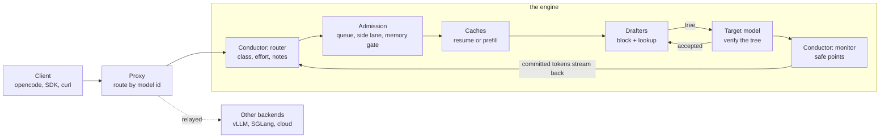

# Overview: what TandemEngine is

TandemLLM runs the models your agents need on your own hardware, behind one OpenAI-compatible address. A coding agent such as opencode or a chat client such as Open WebUI sends its request to that address. TandemLLM picks the model that answers, plans the turn, and watches the turn while it runs.

Several models work on one request. Qwen3.8-27B writes the answer. Two small drafters guess its next tokens and a lookup drafter offers text it has seen before, so one step of the big model commits 4.58 tokens on average on the benchmark row (measured, the paper). More models can run beside them in the same process. Laya's decision models answer typed questions such as “is this turn code or prose”. A Qwen3.5-2B narrator writes one short line about what the big model is doing, and a Qwen3.5-0.8B shadow reader keeps its own copy of each coding session. A residency planner refuses any model that would not fit in memory ([Roles beside the engine](operations.md#roles-beside-the-engine-residency)).

You get on your own machine what a cloud provider gives you. Clients use the OpenAI API with streaming and tool calls. Every request leaves one row in a usage ledger with its tokens and its timings. TandemApp, a separate project with its own docs, puts this engine and other backends (vLLM, SGLang, cloud APIs) behind one address.

An agent's next turn does not read its whole prompt again. The resident prefix keeps the last prompt's rows with a snapshot of the recurrent state every 1,024 tokens, and the end anchor keeps the end of the last answer. A parked session holds a second conversation while another one runs, and the state store keeps whole snapshots. Two caches live on the NVMe and survive a shutdown. The disk tier keeps prefixes that come back. The session spill writes live conversations at a stop and reads them back at the next start: a 41,587-token conversation came back in 0.94 s (measured, the 0.4.0 series). Last, the persistent suffix store keeps the n-gram tables the lookup drafter copies from. [Caches](caches.md) describes every cache.

With memory notes on, the model keeps notes as files, one fact per file and at most 400 words. Notes about the user and about each project last across sessions. Session notes hold what is true for one conversation only ([TandemApp's docs on memory notes](https://github.com/TandemLLM/TandemApp/blob/main/docs/memory.md)).

The engine says what each request is doing right now under `/v1/dashboard/*` and counts it in `/metrics` ([Metrics and the ledger](reference/metrics.md)). TandemApp's dashboard shows it, beside the other engines it watches.

Requests run in parallel. The shipped profile's 8 lanes decode up to eight requests in the same rounds ([Parallel requests](parallel-requests.md)), and the proxy relays any number of requests to other backends at once.

TandemLLM is not tied to one model. Its main model is Qwen3.8-27B, and a second, Qwen3.8-Flash-Next, runs on the same board in its place ([Qwen3.8-Flash-Next](flash-next.md)). The small models are Qwen3.5 and Laya checkpoints, the proxy serves any model behind an OpenAI-compatible API, and [Adding a model](adding-a-model.md) lists the seams where a main model plugs in.

## The test environment

Every number in this book comes from one machine with one main model: an NVIDIA DGX Spark running Qwen3.8-27B. The Spark has a GB10 GPU and 128 GB of memory that the CPU and the GPU share. That is the project's test hardware and its test model, and the project has tested nothing else so far. Its kernels' tile tables and StairCut's price tables come from that board. Much of the engine follows that model's mix of 48 Gated DeltaNet layers and 16 attention layers ([Architecture](architecture.md)).

The project is growing past both. Other CUDA GPUs run the engine with the one Spark-only kernel turned off; their speed has no measurement yet. The proxy and the dashboard run on any machine with Python 3.11. The roadmap ([Roadmap](roadmap.md)) names the next models and boards. When these docs say “the board” or “the model” without a name, it means the DGX Spark and Qwen3.8-27B.

## Two levers

A decode step of Qwen3.8-27B reads about 27 GB of weights in the vendor's FP8 format. The DGX Spark reads its memory at 273 GB/s on paper and about 240 GB/s in practice, so every step costs at least 100 ms before any code runs (arithmetic). That is a ceiling of 10 tokens a second for one request. The engine is built to get under that floor while writing the model's own greedy text.

With the published NVFP4 weights and StairCut on, it writes 49.89 tokens a second for one request on the benchmark row, against 13.69 for plain greedy decoding on the same box (measured, the StairCut paper, 50 requests each). The rest of this section says how.

The engine pulls two levers on the same cost.

The first lever cuts the bytes a step reads. The served weights store every projection in NVFP4, four bits a weight with a scale per 16 weights, and the output head in FP8. A step then reads 15.01 GB instead of 26.93 GB (arithmetic, from the checkpoint's tensor sizes). [Quantisation](quantisation.md) shows how the 4-bit copies were made and what they cost in quality.

The second lever makes each step produce several tokens. Small *drafters* guess the next tokens, and the big model checks all the guesses in one forward pass. A guess the model agrees with is a free token. At the first wrong guess the model puts in its own token, so nothing a drafter proposes reaches the output unless the model would have written it. On the benchmark row a round takes 93.4 ms and commits 4.58 tokens (measured, the paper). That is where the name comes from: two models working in tandem, one guessing and one checking.

The verify is cheap because of the memory floor. A forward pass over 16 tree rows reads the same weights as a pass over one row, so on the published weights at 1k tokens of context it takes 74.4 ms against 75.5 ms for 8 rows (measured, `ops/stair-tables-nvfp4.json`). Extra guesses in the same pass are nearly free until the row count crosses a kernel's tile boundary. StairCut, the router that sizes each round's draft tree, is built on that staircase ([Drafters, StairCut and tree verify](speculative-decoding.md)).

## What is in the repository

This repository is the engine and what it needs to run. The dashboard, Chat, the gateway in front of other engines and cloud APIs, and the fleet of machines are [TandemApp](https://github.com/TandemLLM/TandemApp), a separate project with its own releases.

- **The engine**  `engine/`, `tools/` (kernels) and `server/app.py`: the model, its kernels, the drafters and routers, the caches, and an OpenAI-compatible HTTP server built on Python's standard library. It needs a CUDA GPU (measured on the DGX Spark only), PyTorch, Triton and the weights. The small models run on its own code: the Qwen3.5 narrator and shadow reader on its Qwen forward, Laya's decision models in the same process.
- **The conductor**  `server/conductor/`: a layer in front of the model. It classifies each turn, sets the thinking effort, adds hidden notes and skills, watches the generation for loops and broken tool calls, keeps memory notes and shows the client what it does. It is off unless a configuration directory is given.
- **The contracts**  `contracts/`: the engine's HTTP API, the interface of the extension it loads in chat mode, the control verbs of `tandem remote` and pairing by code. TandemApp copies them at one engine commit and pins them.
- **The installer**  `install.sh`: one command that sets up the served profile on the test board, and best effort on another CUDA GPU. With `--setup` it starts setup mode instead: the Setup Guide in the browser, or `ops/use-profile.sh` from a shell, then downloads and starts any weight profile ([A new box: setup mode, then the Setup Guide](install.md#a-new-box-setup-mode-then-the-setup-guide)).

## What runs today

The roadmap ([Roadmap](roadmap.md)) widens each of these, one step at a time.

- Models: Qwen3.8-27B is the main model the engine serves, a hybrid of 48 Gated DeltaNet layers and 16 attention layers; [Architecture](architecture.md) explains why much of the engine follows that mix. Qwen3.8-Flash-Next, a mixture of experts on the same hybrid, is the second, served from turboderp's EXL3 packs one model at a time ([Qwen3.8-Flash-Next](flash-next.md)). Beside it run the two fine-tuned DFlash2 drafters, the lookup drafter and, when you turn them on, Laya, the narrator and the shadow reader. Behind the proxy, any model a backend serves.
- Hardware: the DGX Spark is the only board with measured kernels and prices ([The test environment](#the-test-environment)). Other CUDA GPUs are best effort.
- Requests: `--parallel N` gives the engine N sequences, and requests that decode at the same time share one draft pass and one verify pass a round ([Parallel requests](parallel-requests.md)). The shipped profile runs 8 lanes since 0.15.0 (SRV-707, `QSE_PARALLEL=8` in `ops/serve.env`), and every weight card has a speed row with 1, 2, 4 and 8 requests at once. With one sequence a request that finds the engine busy waits in a bounded queue, and a short request is served at a safe point inside the running one (the side lane, [The side lane](server.md)). The proxy relays any number of requests to other backends at once ([TandemApp's docs on the conductor in front of any backend](https://github.com/TandemLLM/TandemApp/blob/main/docs/proxy.md#the-harness-in-front-of-a-backend)).

## Two rules

Every change to the engine keeps two rules, and the release gate checks both before anything ships.

The first rule is agreement with greedy decoding. For every greedy request the engine's output tokens equal what plain decoding on the same weights writes, one token at a time, up to the first near tie where the two best tokens are within one unit in the last place. There the batched verify can round the other way. The paper measured how often: of 30 prompts, 17 outputs equal plain greedy decoding to the end of the answer, and 13 diverge at a near tie with a gap of 0.04 to 0.76 ulp (measured). [Exactness](exactness.md) has the full statement and the checks.

The second rule is that no measured number gets worse. A candidate runs against the current release in the same hour on the same box, alternated, and ships only if no figure resolves worse: not the mean, the median, the 90th percentile or the maximum, not the time to first token, and not tokens or milliseconds per round. [Measurement](measurement.md) describes the method and the traps it avoids.

## The headline numbers

the table below collects the numbers that describe the served engine on the test board. Each comes from the StairCut paper's measurements on the published NVFP4 weights, with the lookup drafter's persistent store off.

| what | value |
|-|-|
| single request, StairCut, benchmark row (mean of 50) | 49.89 tok/s |
| the same drafter at a fixed block of 8 | 47.13 tok/s |
| the same drafter at a fixed block of 16 | 44.80 tok/s |
| plain greedy decoding, speculation off | 13.69 tok/s |
| teacher-forced bench, 25 workloads, StairCut | 90.45 tok/s |
| one round on the benchmark row | 93.4 ms, 4.58 tokens |
| time to first token, cold, at 32k / 64k / 128k tokens | 44.4 / 93.7 / 208.3 s |
| the same prompt sent again, resumed from the cache | 0.3 / 0.6 / 1.1 s |
| held-out loss against Qwen's BF16 release, prose / code | +0.0221 / +0.0426 nats |

*The served engine's headline numbers. Source: the StairCut paper, published NVFP4 weights, (measured).*

| decoding | tokens a second, one request (mean of 50) |
|-|-|
| plain greedy decoding | 13.69 |
| fixed block 16 | 44.80 |
| fixed block 8 | 47.13 |
| StairCut | 49.89 |

*Single-request speed on the benchmark row `serve-single-i256-o256-v1`: StairCut against the same drafter at fixed block widths and against plain greedy decoding. Measured: the StairCut paper, published NVFP4 weights, persistent store off.*

These are single-request numbers. Parallel requests on the engine are measured in [Parallel requests](parallel-requests.md). Long prompts are measured separately in [Caches](caches.md). No task benchmark suite has been run, so these docs makes no claim about task accuracy.

## The paper

Khaled Bakeer's paper describes the engine's decoding method:

> Khaled Bakeer. *StairCut: sizing speculative draft trees on a measured verification-cost staircase.* Zenodo, 29 September 2026. [doi:10.5281/zenodo.23045275](https://doi.org/10.5281/zenodo.23045275).

The paper measured the release tagged `v0.2.0-staircut` (commit `c111fa7`) with the published NVFP4 weights on the test board. It backs these parts of this book:

- the draft tree merged from the block drafter and the lookup drafter, and StairCut, which cuts it each round on the measured verify-cost staircase ([Drafters, StairCut and tree verify](speculative-decoding.md));
- the commit of an accepted path through the Gated DeltaNet layers in closed form, and the NVFP4 kernels with a fixed reduction order ([Kernels](kernels.md));
- the NVFP4 quantisation from Qwen's BF16 release and its held-out loss ([Quantisation](quantisation.md));
- the speeds of the table below: 49.89 tok/s for StairCut, 47.13 and 44.80 at fixed blocks of 8 and 16, 13.69 for plain greedy decoding, 50 requests each on the benchmark row, and the teacher-forced bench of 25 workloads;
- the agreement with plain greedy decoding: of 30 outputs, 17 identical to the end of the answer and 13 that part at a near tie ([Exactness](exactness.md));
- the time to first token of a 32k to 128k-token prompt from cold, and again when it resumes from the anchors ([Caches](caches.md)).

What came after that release is not in the paper: image input, the conductor, the caches on the NVMe, memory notes, parallel requests, the proxy and the plugins. Their numbers come from the release series, and the text labels them that way. The release gate holds every later release to the paper's single-request numbers and to the agreement rule. `CITATION.cff` in the repository carries the citation; in BibTeX:

```
@misc{bakeer2026staircut,
  author    = {Bakeer, Khaled},
  title     = {StairCut: sizing speculative draft trees on a measured
               verification-cost staircase},
  year      = {2026},
  publisher = {Zenodo},
  doi       = {10.5281/zenodo.23045275},
  url       = {https://doi.org/10.5281/zenodo.23045275}
}
```

## Credits

Qwen made the model weights and their reference implementation. The base block drafter is DFlash2 for Qwen3.8-27B, released by its vendor under Apache-2.0. The engine runs on PyTorch and Triton over CUDA, and its own kernels are written in Triton and CUDA. The lookup corpus that the installer builds comes from public, permissively licensed text. The decision models the conductor can ask are Laya's published checkpoints (Apache-2.0).

## One request, end to end

This page follows one chat completion from a coding agent through every part of TandemLLM. Each step names the page that explains it. The figure below is the map.



*The request path. A client sends an OpenAI request; the proxy routes it by model id; the conductor's router plans the turn; admission decides when it runs; the caches decide where the prefill starts; then drafters and the target model take turns, round after round, while the conductor's monitor watches the output at fixed safe points. Requests for other backends leave at the proxy.*

### The client sends a request

The client is any program that speaks the OpenAI chat completions API: the OpenAI SDK, opencode, the Hermes agent, Open WebUI or `curl`. It sends `POST /v1/chat/completions` with its messages, its tools and its options, usually streamed. The engine's server reads every OpenAI field it can honour, accepts the ones that have no effect here, and refuses the rest with a 400 that names the field ([What the API supports](server.md#what-the-api-supports)).

### The proxy routes it

When TandemApp's controller (`tandem-app`) is in front, the request is routed by its `model` field. A model of another backend (vLLM, SGLang, a cloud API) is relayed there: the answer's bytes go back to the client unchanged, and the proxy writes one ledger row with the tokens, the time to first token, the decode rate and the cost. A request for `TandemLLM` goes to the engine. [TandemApp's backends page](https://github.com/TandemLLM/TandemApp/blob/main/docs/backends.md) sets this up, and [its proxy page](https://github.com/TandemLLM/TandemApp/blob/main/docs/proxy.md#the-harness-in-front-of-a-backend) puts the conductor in front of other backends.

### The conductor plans the turn

With a conductor configuration the server serves one model name, `TandemLLM`: the weights with a conductor in front. Before the request queues, the conductor resolves a *profile* (by header, by client, or the default), and its router decides what kind of task the turn is. A tool-result turn keeps the session's class; only a new user message asks a classifier, and the default classifier is Qwen itself under a choice grammar. The class sets the thinking budget and adds a hidden note at the end of the last message: the effort sentence, rules and *packages* (skill texts). Later turns replay that note at the same token position, so the cached prefix keeps matching. [TandemApp's docs on profiles and the router](https://github.com/TandemLLM/TandemApp/blob/main/docs/conductor.md) explains the router and [TandemApp's docs on packages, the library and the deciders](https://github.com/TandemLLM/TandemApp/blob/main/docs/chat-mode.md) the packages.

A client's side request, such as opencode's title call, is recognised by its shape and served small: no classifier, no note, at most 64 output tokens for a title.

### Admission decides when it runs

The engine holds one sequence unless `--parallel N` gives it more ([Parallel requests](parallel-requests.md)). A request that finds it busy waits in a bounded queue (8 by default). A streamed request that waits more than 10 s gets its stream opened and an SSE comment every 10 s, with an estimate of the wait. A short request (at most 2,048 prompt tokens and 64 output tokens, thinking off) does not wait at all: the running generation serves it at its next safe point, between two decode blocks or two prefill chunks, and gets its state back byte for byte. Before every prefill a memory gate checks that the prompt's workspace fits under the declared peak, giving caches back cheapest first. [Serving](server.md) covers the queue, the side lane and the memory gate.

### The caches decide where the prefill starts

A prefill is the most expensive thing the engine does: 208.3 s for a 128k-token prompt from cold (measured, the paper). Before it prefills, the engine looks for state it already has. In an agent session each turn's prompt is the previous prompt plus the answer plus a tool result, and the *resident prefix* still holds the previous turn's rows in the engine's own buffers, with recurrent-state *anchors* every 1,024 tokens and an *end anchor* at the end of the last generation. The next turn resumes there and forwards only what is new. Further down are a state store of snapshots, a disk tier on the NVMe for prefixes that come back, and a session spill that keeps whole conversations through a restart. [Caches](caches.md) describes them all.

### The decode loop

Then rounds run until the answer ends. In each round the block drafter proposes up to 15 tokens and the lookup drafter proposes continuations it has seen before; StairCut merges them into one tree and cuts it to the size that maximises expected tokens per millisecond on the measured verify cost. One forward pass of the target model verifies the whole tree through all 64 layers. The engine walks the tree with the model's own tokens, keeps the longest agreeing path plus one token of the model's own, and commits that path's KV rows and recurrent state. [Drafters, StairCut and tree verify](speculative-decoding.md) explains the round and [Kernels](kernels.md) the kernels that make the verify cheap.

### The monitor watches the output

While the model writes, the conductor's *session monitor* reads the output at four safe points: before the prefill, after every committed block, at the end token, and when the answer's tool calls are complete. It can close a reasoning block that loops, continue a turn that ended empty, repair or regenerate a malformed tool call, and stop a tool call whose arguments repeat. Everything it adds is hidden from the client and never counted in `usage`. [TandemApp's docs on the session monitor](https://github.com/TandemLLM/TandemApp/blob/main/docs/session-monitor.md) lists its tasks.

### The stream goes back

Committed tokens stream to the client as they are verified, several at a time. A tool call streams as argument deltas while the model writes it, with values typed by the request's JSON schema. With a profile's status lines on, the client also sees one short line for each step the conductor takes (“› reading 20,745 tokens, about 18 s left”), which the engine strips again from the next prompt ([TandemApp's docs on status lines, the voice and the shadow reader](https://github.com/TandemLLM/TandemApp/blob/main/docs/status-lines.md)).

### After the request

The request leaves one log line (counts, finish reason, rate, never text) and one row in the usage ledger. The conductor writes its decisions to a journal, a transcript block for a request with tools, and, when memory notes are on, any `<tandem_memory>` block the model wrote. When the session goes quiet, a background writer may write the session's facts as notes ([TandemApp's docs on memory notes](https://github.com/TandemLLM/TandemApp/blob/main/docs/memory.md)). `/v1/dashboard/*` serves all of it live, and TandemApp's dashboard shows it.

